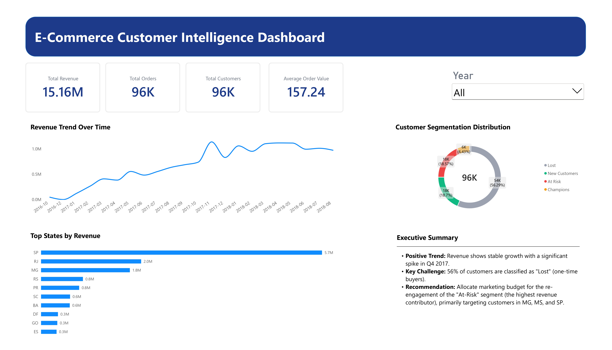
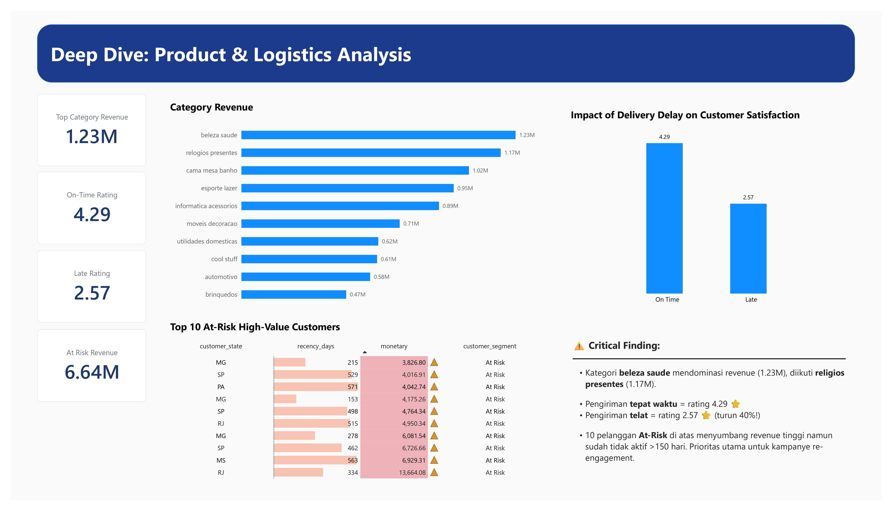

# 🛒 E-Commerce Customer Intelligence & RFM Dashboard

An end-to-end Business Intelligence project analyzing 96,000+ e-commerce transactions (Olist dataset) to identify customer behavior patterns, optimize revenue retention, and drive data-driven marketing strategies.

---

##  Dashboard Preview

### 📄 Page 1: Executive Overview

*High-level KPIs, revenue trends, customer segmentation (RFM), and regional performance.*

### 🔍 Page 2: Deep Dive - Product & Logistics Analysis

*Category revenue breakdown, delivery delay impact on customer satisfaction, and top At-Risk high-value customers.*

---

##  Key Business Insights

1. **The Retention Crisis:** Over 56% of the customer base is classified as "Lost" (one-time buyers), indicating a severe leak in the customer lifecycle.
2. **Category Dominance:** "Beleza Saude" (Health & Beauty) leads category revenue (1.23M), followed by "Religios Presentes" (1.17M).
3. **Logistics Impact on Satisfaction:** On-time deliveries yield an average rating of **4.29 ⭐**, while late deliveries plummet to **2.57 ⭐** (a 40% drop in satisfaction).
4. **Actionable Target:** The "At-Risk" segment contributes the highest revenue but has been inactive for >150 days. Priority re-engagement campaigns should target customers in **MG, MS, and SP**.

---

## 🛠️ Tech Stack & Methodology

* **Database & ETL:** PostgreSQL (Data cleaning, Star Schema modeling, Advanced SQL).
* **Analysis:** RFM Analysis (Modified 2D Recency & Monetary using Dynamic Thresholding/Percentiles).
* **Visualization:** Power BI (DAX, Data Modeling, Interactive Dashboards, Conditional Formatting).

---

## 📁 Repository Structure

* `schema.sql`: Database schema creation (Star Schema: Fact & Dimension tables).
* `data_cleaning.sql`: Data transformation and cleaning scripts.
* `rfm_analysis.sql`: Advanced SQL logic for dynamic customer segmentation.
* `olist_ecommerce_dashboard.pbix`: The interactive Power BI dashboard file.
* `E-Commerce_Retention_Strategy_Memo.pdf`: 1-page executive memo with strategic recommendations.

---

##  How to Use

1.**Import Data:** Download the raw dataset from [Kaggle: Brazilian E-Commerce](https://www.kaggle.com/datasets/olistbr/brazilian-ecommerce) and import the CSV files into the respective tables.
2. **Clone the repository:**
   ```bash
   git clone https://github.com/vistadev-prog/olist-ecommerce-bi-portfolio.git
