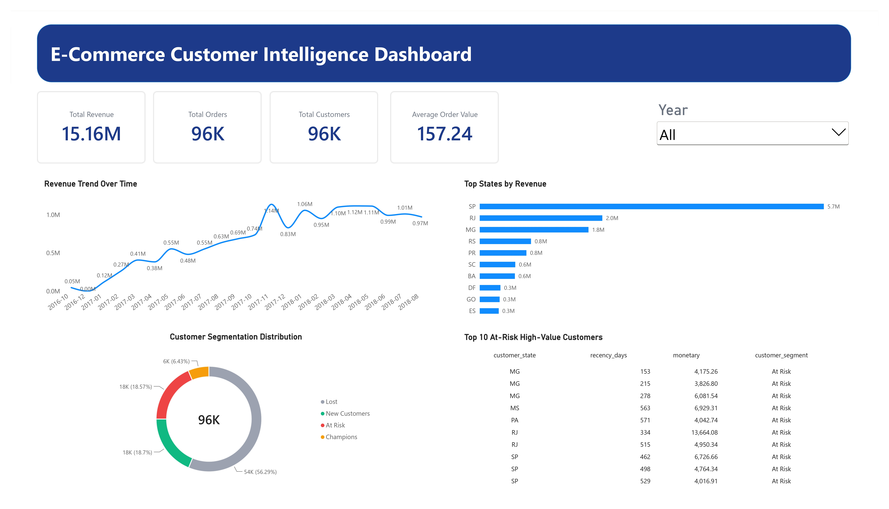

# olist-ecommerce-bi-portfolio
End-to-end BI Dashboard for E-Commerce Customer Segmentation (RFM Analysis) using PostgreSQL and Power BI.

## 📊 E-Commerce Customer Intelligence Dashboard

### 📌 Project Overview
Dashboard ini menganalisis data transaksi e-commerce (Olist) untuk mengidentifikasi perilaku pelanggan dan memaksimalkan retensi. Menggunakan pendekatan RFM (Recency, Frequency, Monetary) yang dimodifikasi menjadi segmentasi 2D karena karakteristik dataset yang didominasi *one-time buyers*.

### 🛠️ Tech Stack
- **Database**: PostgreSQL (Star Schema Modeling, Data Cleaning)
- **BI Tool**: Power BI (DAX, Data Modeling, Interactive Visuals)
- **Analysis**: SQL (CTEs, Window Functions, Percentiles)

### 💡 Key Business Insights
1. **Critical Retention Issue**: 56% pelanggan dikategorikan "Lost" (tidak aktif & nilai belanja rendah).
2. **Hidden Revenue Opportunity**: Segmen "At Risk" (18% pelanggan) menyumbang revenue tertinggi namun sudah tidak aktif >300 hari. Ini adalah target utama kampanye *re-engagement*.
3. **Growth Trend**: Bisnis menunjukkan pertumbuhan stabil dengan lonjakan signifikan di Q4 2017 (diduga efek Black Friday).

### 🚀 How to Use
1. Clone repository ini.
2. Jalankan script SQL di `schema.sql` dan `rfm_analysis.sql` pada database PostgreSQL Anda.
3. Impor dataset dari [Kaggle Olist](https://www.kaggle.com/datasets/olistbr/brazilian-ecommerce).
4. Buka file `.pbix` di Power BI Desktop dan hubungkan ke database lokal Anda.
